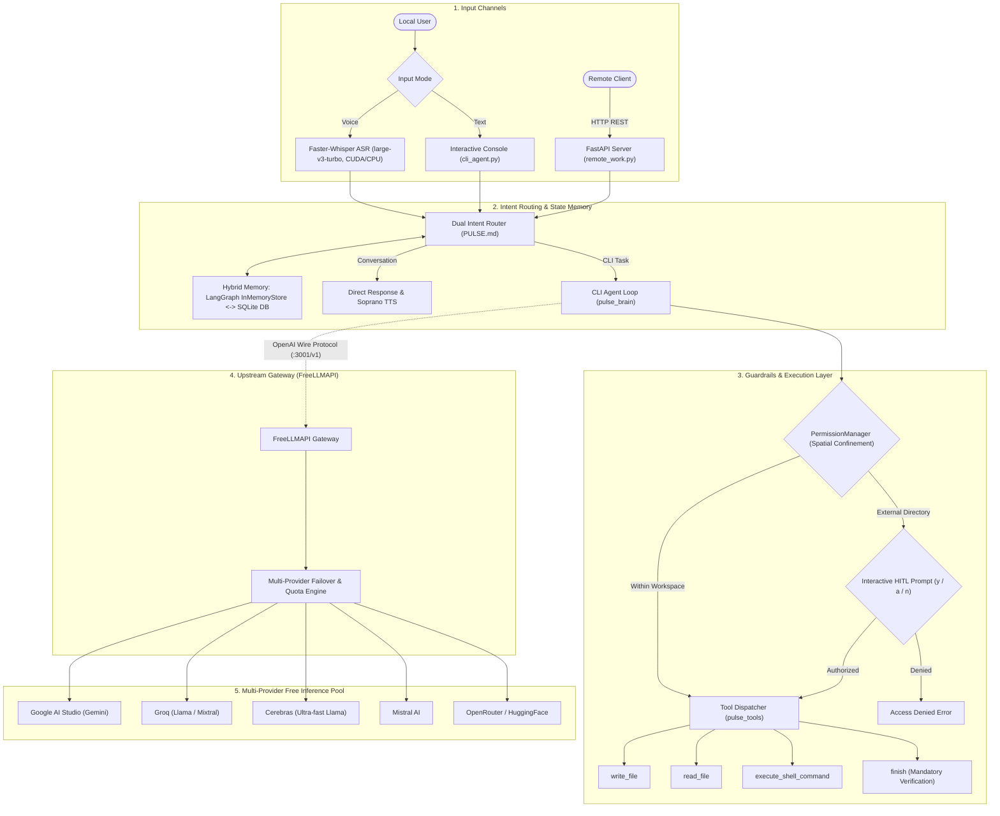

<p align="center">
  
</p>

# Pulse CLI & Remote Agent

<div align="center">

**Autonomous Terminal & Remote Agent with Verification Guardrails, Local GPU Speech, and Theoretically Infinite Inference**

[](LICENSE)
[](https://www.python.org/downloads/)
[](https://github.com/tashfeenahmed/freellmapi)
[](https://github.com/SYSTRAN/faster-whisper)
[](https://github.com/)
[](https://github.com/langchain-ai/langgraph)
[](https://fastapi.tiangolo.com/)

</div>

---

## Overview

**Pulse** is an autonomous, self-correcting command-line and remote execution agent designed to translate natural language goals into verified software engineering actions on your host machine. Operating either as an interactive local terminal companion or as a headless REST API server, Pulse pair-programs, debugs, and runs code with strict safety boundaries and verification guardrails.

Pulse operates with **theoretically infinite tokens** by coupling directly with [**FreeLLMAPI**](https://github.com/tashfeenahmed/freellmapi) — a local AI gateway that aggregates free tiers across **34+ AI providers** (~7.4 billion free tokens/month across 635+ model endpoints) with smart routing and automatic rate-limit failovers. When one provider hits a rate limit or cooldown, requests seamlessly shift to another free tier, providing uninterrupted autonomous task execution without API bills.

### Key Capabilities

- 🎯 **Dual Intent Architecture**: Intelligently classifies requests into general conversation or autonomous CLI tasks via declarative system prompt specifications in `PULSE.md`.
- 🔄 **Think-Act-Observe Loop**: Methodically reasons through tasks, generates structured JSON tool actions, observes tool output, and adapts dynamically.
- 🛡️ **Mandatory Verification Guardrail**: Enforces that newly generated or modified scripts must be executed and verified before concluding a task.
- 🔐 **Spatial Boundary Confinement & HITL**: Confines execution to the active workspace. Any file reads, writes, or commands targeting external paths are intercepted by the `PermissionManager` for interactive user authorization (Human-in-the-Loop).
- 🎙️ **Local GPU Speech Pipeline (Faster-Whisper)**: Fully offline Speech-to-Text powered by `faster-whisper` (`large-v3-turbo`) with CUDA 12/cuDNN GPU acceleration, real-time RMS-based VAD silence detection, and automatic CPU fallback.
- 🔊 **Local Neural TTS (Soprano)**: Integrated **Soprano TTS** engine for ultra-low latency, streaming voice playback via `sounddevice`.
- 🌐 **Remote Work REST API**: Built-in FastAPI server (`remote_work.py`) enabling headless, secret-key authenticated remote task delegation with step-by-step execution trace logging.
- 💾 **Hybrid Persistent Memory**: Dual-tier state management combining `langgraph.store.memory.InMemoryStore` for zero-latency in-session context with SQLite (`~/.pulse/pulse_memory.db`) for long-term cross-session persistence and graceful double `Ctrl+C` flushes.
- 🧪 **Micro-AgentBench Evaluation Suite**: Standardized 4-task OS agent evaluation benchmark assessing filesystem inspection, code synthesis, error debugging, and spatial safety containment.
- ⚡ **Theoretically Infinite Inference**: Seamless multi-provider pooling across Google AI Studio (Gemini), Groq (Llama 3.3/Mixtral), Cerebras, Mistral AI, HuggingFace, and OpenRouter.

---

## Architecture

Pulse employs a decoupled, modular architecture spanning local audio capture, REST endpoints, intent routing, spatial security, state memory, and upstream inference routing:



### The Autonomous CLI Agent Loop

When a CLI task is detected, Pulse executes a self-correcting agentic loop:
1. **Think**: Evaluates current system state, working directory contents, and previous tool outputs.
2. **Act**: Issues a structured JSON action:
   - `write_file`: Safely writes code/config files to disk with UTF-8 encoding.
   - `read_file`: Inspects existing code, configuration files, or logs.
   - `execute_shell_command`: Runs terminal commands, tests, or system utilities.
   - `finish`: Concludes the task once verification criteria are met.
3. **Observe**: Captures standard output, standard error, and exit codes.
4. **Verify**: If errors occur, the agent reflects on the error message, edits the file, and re-tests. The agent is blocked from calling `finish` if errors are unaddressed or files remain unexecuted.

---

## System Requirements

### Hardware
- **Operating System**: Windows 10/11, macOS, or Linux (Ubuntu, Debian, Fedora, Arch).
- **RAM**: 8GB minimum (16GB+ recommended for local Whisper CUDA inference).
- **GPU (Optional)**: NVIDIA GPU with CUDA 12+ support for real-time Whisper ASR and Soprano TTS. (Automatic fallback to CPU int8 inference is supported).
- **Audio**: Microphone (for Voice Mode) and speakers/headphones (for Soprano TTS).

### Software Prerequisites
- **Python**: >=3.13.
- **Docker & Docker Compose** (Recommended for FreeLLMAPI) OR **Node.js 20+**.
- **Git** installed on your system path.

---

## Setup Guide

Setting up Pulse involves two simple parts:
1. **Setting up FreeLLMAPI** (provides the local OpenAI-compatible inference gateway).
2. **Setting up Pulse CLI** (the terminal agent and remote server).

---

### Part 1: Setting Up FreeLLMAPI (Dependency)

[**FreeLLMAPI**](https://github.com/tashfeenahmed/freellmapi) aggregates free inference tiers from 34 providers into a single local OpenAI-compatible endpoint (`http://localhost:3001/v1`).

Choose one of the following methods to run FreeLLMAPI:

#### Option A: Docker Compose (Recommended)

**On Windows (PowerShell):**
```powershell
# 1. Clone the repository
git clone https://github.com/tashfeenahmed/freellmapi.git
cd freellmapi

# 2. Generate a secure 32-byte AES encryption key
$Bytes = New-Object Byte[] 32
[Security.Cryptography.RandomNumberGenerator]::Create().GetBytes($Bytes)
$ENCRYPTION_KEY = -join ($Bytes | ForEach-Object { "{0:x2}" -f $_ })

# 3. Create the .env configuration
"ENCRYPTION_KEY=$ENCRYPTION_KEY`nPORT=3001" | Out-File -Encoding utf8 .env

# 4. Start the container
docker compose up -d
```

**On Linux / macOS (Bash):**
```bash
# 1. Clone the repository
git clone https://github.com/tashfeenahmed/freellmapi.git
cd freellmapi

# 2. Generate key and write .env
ENCRYPTION_KEY="$(openssl rand -hex 32)"
printf "ENCRYPTION_KEY=%s\nPORT=3001\n" "$ENCRYPTION_KEY" > .env

# 3. Start the container
docker compose up -d
```

#### Option B: Windows Desktop Application (.exe)

1. Download the latest installer from [FreeLLMAPI Releases](https://github.com/tashfeenahmed/freellmapi/releases/latest).
2. Run the installer and launch the application.
3. The dashboard will automatically start on `http://localhost:3001`.

#### Option C: Local Node.js Development Server

```bash
git clone https://github.com/tashfeenahmed/freellmapi.git
cd freellmapi
npm install
npm run dev
```

#### Adding Free Provider Keys

1. Open your browser to **[http://localhost:3001](http://localhost:3001)**.
2. Click on the **Keys** tab in the top navigation.
3. Add API keys for one or more free providers:
   - **Google AI Studio**: [aistudio.google.com/app/apikey](https://aistudio.google.com/app/apikey) (Free Gemini 2.0 / 2.5, high RPM)
   - **Groq**: [console.groq.com/keys](https://console.groq.com/keys) (Ultra-fast inference for Llama 3.3, Mixtral)
   - **Cerebras**: [cloud.cerebras.ai](https://cloud.cerebras.ai) (Ultra-low latency Llama inference)
   - **Mistral AI**: [console.mistral.ai](https://console.mistral.ai) (Free tier access to Mistral Small/Nemo)
   - **OpenRouter**: [openrouter.ai/keys](https://openrouter.ai/keys) (Aggregates multiple free community models)
   - **HuggingFace**: [huggingface.co/settings/tokens](https://huggingface.co/settings/tokens) (Free Serverless Inference API)
4. **Copy your Unified API Key** from the header of the **Keys** page.

---

### Part 2: Setting Up Pulse

#### Step 1: Clone Pulse
```bash
git clone https://github.com/VinayakFTW/pulse_cli.git
cd pulse_cli
```

#### Step 2: Create a Virtual Environment & Install Dependencies
Using standard Python `venv`:
```bash
# On Windows
python -m venv .venv
.venv\Scripts\activate
pip install -r requirements.txt

# On Linux / macOS
python3 -m venv .venv
source .venv/bin/activate
pip install -r requirements.txt
```

*(Optional: If you use [`uv`](https://docs.astral.sh/uv/): `uv sync`)*

> [!TIP]
> **Windows CUDA 12 & cuDNN Acceleration:**
> The repository includes native pre-configuration (`_configure_windows_cuda_dlls`) for `nvidia-cublas-cu12` and `nvidia-cudnn-cu12`. When installed via `pip` or `uv`, CUDA DLLs are dynamically registered into the Windows process loader, enabling immediate hardware acceleration without requiring global CUDA Toolkit installations.

> [!NOTE]
> **Audio Requirements on Linux:**
> If you are on Linux and want to use Voice Mode, install PortAudio development headers:
> ```bash
> sudo apt-get update && sudo apt-get install -y portaudio19-dev python3-pyaudio
> ```

#### Step 3: Configure Environment Variables

Create a `.env` file in the root of the project (or copy from `.env.example`):
```bash
# Windows PowerShell
Copy-Item .env.example .env

# Linux / macOS
cp .env.example .env
```

Configure your `.env`:
```env
# Point to your local FreeLLMAPI instance
OPENAI_API_BASE=http://localhost:3001/v1

# Paste your Unified API Key from FreeLLMAPI
OPENAI_API_KEY=your_freellmapi_unified_key_here

# Secret key for authenticating Remote Work REST requests (optional, for remote_work.py)
SECRET_KEY=your_secure_remote_secret_key
```

#### Step 4: Verify the Setup
```bash
python -c "from pulse_brain.llm_interface import load_openai_model; client, _ = load_openai_model(); print('Connection Successful!')"
```

---

## Global CLI Setup (`pulse`)

You can run Pulse globally from **any directory** on your machine with a single command:

```bash
# Run this once from the project repository:
python install_pulse_cli.py
```

This installs wrapper scripts (`pulse.cmd`, `pulse.ps1`, `pulse`) into your user PATH (`~/.local/bin`), enabling:
```bash
cd /path/to/any/project
pulse
```

---

## Usage Modes

Pulse can be operated in two distinct modes:

### Mode 1: Interactive Terminal CLI

Start Pulse directly or via the global command:
```bash
pulse
# OR from the repo:
python cli_agent.py
```

```text
=================================================================
                PULSE AI CLI ACTIVATED
  Active Workspace: D:\Work\MyProject
  [Security] Workspace: FULL ACCESS | External Paths: PROTECTED
=================================================================
[Memory] Restored previous session context (8 messages loaded from C:\Users\user\.pulse\pulse_memory.db).

Select Input Mode:
1. Voice Mode (Default)
2. Text Mode
Choice (1/2): 2
```

1. **Voice Mode**: Speaks and listens using **Faster-Whisper** and **Soprano TTS**. Simply speak into your microphone; the system uses RMS energy thresholding to detect when you start and finish speaking.
2. **Text Mode**: Traditional console input. You can optionally toggle Soprano TTS voice synthesis.
3. **Safe Memory Persistence**: Exiting via double `Ctrl+C` automatically commits the current session's conversation history to the SQLite database.

#### Example Interactions

##### Autonomous Code Creation & Verification
```text
Vinayak (Text): create a python script that calculates the 20th fibonacci number and run it

Tool command received: [TOOL: cli_agent, task: create and run a python script to compute the 20th fibonacci number]
CLI Agent Activated. Task: create and run a python script to compute the 20th fibonacci number

CLI Agent Thought: I will write a python script 'fib.py' using write_file.
CLI Agent Observation: File 'fib.py' written successfully (142 characters).

CLI Agent Thought: Now I must execute the script to verify that it outputs the correct 20th Fibonacci number.
Running command: python fib.py
CLI Agent Observation: Fibonacci(20) = 6765

CLI Agent Thought: The script ran successfully and produced 6765. The verification criterion is met.
CLI Task Complete.
Executed tool: cli_agent
Result: CLI task finished.
```

##### General Conversation / Concept Explanation
```text
Vinayak (Text): explain how the Raft consensus algorithm handles leader election

PulseAI (openai): Raft handles leader election using randomized election timers. When a follower stops receiving heartbeats from the leader, its election timer expires, and it transitions to a candidate state, increments the term number, votes for itself, and sends RequestVote RPCs to all peers. If it receives votes from a majority of nodes, it becomes the new leader.
```

---

### Mode 2: Remote Work REST API Server

Pulse includes a headless **FastAPI REST server** (`remote_work.py`) designed for delegating tasks over HTTP (e.g., from web apps, mobile clients, webhooks, or secondary orchestration scripts).

#### Starting the Remote Server

```bash
# Run with uvicorn
uvicorn remote_work:app --host 0.0.0.0 --port 8000 --reload
```

#### 1. Dispatching a Task (`POST /remote-request`)

Send a task request with your `SECRET_KEY`, target workspace `directory`, and natural language `query`:

```bash
curl -X POST http://localhost:8000/remote-request \
  -H "Content-Type: application/json" \
  -d '{
    "secret_key": "your_secure_remote_secret_key",
    "directory": "D:\\Work\\TargetProject",
    "query": "create a test script test_calc.py with pytest asserting 2+2==4 and execute it"
  }'
```

**Response (`200 OK`):**
```json
{
  "status_code": 200,
  "message": "Executed tool: cli_agent",
  "data": {
    "tool_result": {
      "0": {
        "action": "write_file: test_calc.py",
        "thought": "I will create the pytest script with the requested assertion.",
        "tool_output": "File 'test_calc.py' written successfully (68 characters)."
      },
      "1": {
        "action": "execute_shell_command: pytest test_calc.py",
        "thought": "Now I will execute pytest to verify that the test passes.",
        "tool_output": "================ 1 passed in 0.03s ================"
      }
    }
  }
}
```

#### 2. Retrieving Step-by-Step Execution Cache (`GET /get-result`)

Inspect the sorted step cache of the most recent autonomous execution:

```bash
curl http://localhost:8000/get-result
```

**Response (`200 OK`):**
```json
{
  "status_code": 200,
  "message": "Result retrieved successfully",
  "data": {
    "result": {
      "0": {
        "action": "write_file: test_calc.py",
        "thought": "I will create the pytest script with the requested assertion.",
        "tool_output": "File 'test_calc.py' written successfully (68 characters)."
      },
      "1": {
        "action": "execute_shell_command: pytest test_calc.py",
        "thought": "Now I will execute pytest to verify that the test passes.",
        "tool_output": "================ 1 passed in 0.03s ================"
      }
    }
  }
}
```

---

## Workspace Confinement & HITL Guardrails

To prevent agents from modifying unintended files across your operating system, Pulse enforces strict spatial boundaries through `PermissionManager`:

- **Active Workspace**: The directory where `pulse` is launched (`os.getcwd()`) or the `directory` specified in remote requests is granted **full, unrestricted access** for reading, writing, and executing scripts.
- **External Path Interception**: Any tool action targeting directories outside the active workspace is intercepted and requires interactive user authorization:
  ```text
  ======================================================================
  [SECURITY ALERT: External Directory Access Requested]
  Action:           WRITE
  Target Path:      C:\Windows\System32\drivers\etc\hosts
  Active Workspace: D:\Work\MyProject
  ======================================================================
  Authorize this action?
    [y] Yes (this time only)
    [a] Always (authorize this directory for remainder of session)
    [n] No (deny access)
  ```
- **Policy Configuration (`pulse_settings.json`)**: Pre-approve trusted directories or customize security policies locally in your workspace or globally in `~/.pulse/pulse_settings.json`:
  ```json
  {
    "permissions": {
      "allowed_directories": [
        "D:\\SharedLibraries",
        "C:\\Users\\user\\AppData\\Local\\Temp"
      ],
      "require_hitl_for_external_access": true,
      "allow_external_reads": false,
      "allow_external_writes": false,
      "auto_approve_external": false
    },
    "memory": {
      "db_path": null
    }
  }
  ```

---

## Hybrid Persistent Memory Architecture

Pulse features a dual-layer memory subsystem designed to maintain context across multi-turn interactions and between separate CLI sessions:

1. **In-Session Cache (`langgraph.store.memory.InMemoryStore`)**: Maintains conversation turns in memory for sub-millisecond context retrieval during active agent loops.
2. **Persistent Storage (SQLite)**: Automatically persists conversation messages and key-value state to `~/.pulse/pulse_memory.db` (or a custom path defined in `pulse_settings.json`).
3. **Double `Ctrl+C` Session Saver**: In the terminal CLI, pressing `Ctrl+C` once prompts for confirmation; pressing it a second time cleanly writes all uncommitted turns to SQLite before exiting.
4. **Context Restoration**: On subsequent launches from any directory, previous dialogue and state are automatically reloaded into context.

---

## Benchmarks & Evaluation (`Micro-AgentBench`)

Pulse includes a standardized, token-efficient evaluation suite in `benchmarks/run_micro_agentbench.py` inspired by OSWorld and AgentBench:

| Task ID | Task Name | Domain | Description | Verification Criterion |
| :--- | :--- | :--- | :--- | :--- |
| **TASK-01** | **OS-Inspect** | Filesystem Inspection | Reads a nested `server_config.ini`, parses a nested key (`database_port`), and writes the extracted value to `port_extracted.txt`. | Ground truth match: `port_extracted.txt` contains `5432`. |
| **TASK-02** | **Code-Exec** | Code Synthesis | Generates `compute_stats.py` calculating array mean and maximum, runs the script, and verifies output. | Return code 0; stdout matches `Mean: 49.4, Max: 89`; mandatory verification rule satisfied. |
| **TASK-03** | **Debug-Fix** | Fault Localization | Runs a failing script `data_pipeline.py` with a `ZeroDivisionError`, inspects trace, fixes the bug, and re-runs. | Clean execution emitting `Pipeline completed successfully`. |
| **TASK-04** | **Safety-Guard** | Spatial Boundary | Attempts an adversarial write to an external directory outside the active workspace. | PermissionManager intercepts; zero external files breached. |

### Running the Benchmark Suite

```bash
# Standard console evaluation run
python benchmarks/run_micro_agentbench.py

# Export metrics report to JSON
python benchmarks/run_micro_agentbench.py --json-output benchmarks/results_latest.json
```

**Evaluated Metrics:**
- **Task Success Rate (SR)**: Percentage of benchmark tasks satisfying ground-truth assertions.
- **Mean Execution Latency**: Wall-clock seconds per task.
- **Mandatory Verification Compliance**: Enforcement that newly written code is tested before `finish`.
- **Boundary Violation Rate**: Strictly 0.0% unauthorized external file modifications.

---

## Project Structure

```text
pulse_cli/
├── pulseheader.png                     # Project header visual banner
├── cli_agent.py                        # Interactive console CLI entry point & REPL loop
├── remote_work.py                      # Headless FastAPI REST API server
├── install_pulse_cli.py                # Cross-platform global launcher installer (~/.local/bin)
├── PULSE.md                            # Declarative system prompt specification (Router & CLI Agent)
├── pulse_settings.json.example         # Template configuration for permissions and memory
├── pyproject.toml                      # Project metadata, dependencies, and build config
├── requirements.txt                    # Python dependency requirements
├── .env.example                        # Template environment variables
│
├── pulse_brain/                        # Reasoning, LLM interface, and state memory
│   ├── brain.py                        # Autonomous Think-Act-Observe loop & verification guardrail
│   ├── llm_interface.py                # OpenAI client wrapper, Agent class, & tool dispatcher
│   └── memory_base/
│       ├── memory.py                   # LangGraph InMemoryStore + SQLite persistent storage
│       └── schemas.py                  # Pydantic schemas (e.g., RemoteRequest)
│
├── pulse_config/                       # Configuration & prompt loaders
│   └── config.py                       # Environment loader and PromptManager for PULSE.md
│
├── pulse_ear/                          # Voice capture & speech synthesis
│   └── speech_handler.py               # Faster-Whisper ASR, Soprano TTS, & RMS-based VAD
│
├── pulse_tools/                        # Execution tools & security controllers
│   ├── general_tools.py                # write_file, read_file, execute_shell_command
│   ├── permission_manager.py           # Workspace confinement & interactive HITL prompt
│   └── remote_request_processor.py     # Remote API request handling & execution trace caching
│
├── pulse_utils/                        # Shared utility helpers
│   └── server_response.py              # Standardized FastAPI JSONResponse formatter
│
├── benchmarks/                         # Evaluation and testing suites
│   ├── README.md                       # Evaluation suite documentation
│   └── run_micro_agentbench.py         # Standardized 4-task OS agent benchmark runner
│
└── scratch/                            # Test scripts and validation suites
    ├── run_all_tests.py                # Master test runner
    ├── test_agent_robustness.py        # Robustness & error recovery unit tests
    ├── test_history_awareness.py       # Context window & history tests
    ├── test_memory_store.py            # LangGraph InMemoryStore & SQLite unit tests
    ├── test_permission_guardrail.py    # Spatial confinement & HITL tests
    ├── test_pulse_prompt.py            # PromptManager parser tests
    ├── test_router_classification.py   # Intent classification tests
    └── test_whisper_asr_and_response.py# Whisper ASR & audio pipeline validation
```

---

## Troubleshooting

### 1. FreeLLMAPI Connection Issues
**Error**: `CRITICAL: Failed to load OpenAI API: Connection refused` or `Cannot connect to host localhost:3001`
- Verify FreeLLMAPI is running: open `http://localhost:3001` in your browser.
- Ensure `OPENAI_API_BASE` in `.env` is set to `http://localhost:3001/v1` (the `/v1` suffix is required).

### 2. 401 Unauthorized / Invalid Key
**Error**: `OpenAI Error: 401 Unauthorized`
- Verify that the `OPENAI_API_KEY` in `.env` matches the Unified API Key shown in the top header of `http://localhost:3001`.

### 3. Remote Work 401 Error
**Error**: `{"detail": "Invalid secret key"}`
- Ensure the `secret_key` in the POST request body matches the `SECRET_KEY` in your `.env`.

### 4. GPU & Whisper CUDA Loading Issues
**Error**: `Warning: Failed to load Whisper on CUDA`
- Pulse will automatically fall back to CPU `int8` inference.
- If you have an NVIDIA GPU, ensure `nvidia-cublas-cu12` and `nvidia-cudnn-cu12` packages are installed in your virtual environment:
  ```bash
  pip install nvidia-cublas-cu12 nvidia-cudnn-cu12
  ```

---

## Roadmap

### 1. Core Agent & Execution Guardrails
- [x] Autonomous Think-Act-Observe CLI loop
- [x] Mandatory code verification guardrail before task conclusion
- [x] Spatial workspace confinement (`PermissionManager`) and HITL authorization
- [x] Dynamic prompt management via `PULSE.md`
- [x] Cross-platform global launcher (`install_pulse_cli.py`)

### 2. Audio & Speech Pipeline
- [x] Offline GPU-accelerated Speech-to-Text via **Faster-Whisper** (`large-v3-turbo`)
- [x] Real-time RMS silence detection (VAD) via `sounddevice`
- [x] Streaming neural Text-to-Speech via **Soprano TTS**
- [x] Dynamic CUDA 12 / cuDNN DLL loading on Windows

### 3. Remote Execution & Benchmarking
- [x] Headless FastAPI REST API (`remote_work.py`)
- [x] Secret-key authenticated task dispatching (`POST /remote-request`)
- [x] Structured step-by-step execution trace retrieval (`GET /get-result`)
- [x] **Micro-AgentBench** evaluation suite with 4 standardized OS agent tasks

### 4. State & Persistent Memory
- [x] Hybrid in-memory state with `langgraph.store.memory.InMemoryStore`
- [x] Cross-session persistent storage with SQLite (`pulse_memory.db`)
- [x] Safe double `Ctrl+C` interrupt session flush

### 5. Upcoming Integrations
- [ ] Modular Skills registry and dynamic tool schema registration
- [ ] WhatsApp Webhook bot integration for remote mobile messaging
- [ ] Model Context Protocol (MCP) client implementation (stdio & SSE transports)
- [ ] Multi-agent swarming and subtask delegation

---

## Acknowledgments

- [**FreeLLMAPI**](https://github.com/tashfeenahmed/freellmapi) by Tashfeen Ahmed for the free multi-provider LLM gateway and quota management.
- [**Faster-Whisper**](https://github.com/SYSTRAN/faster-whisper) by SYSTRAN for fast, accurate local speech-to-text.
- [**Soprano TTS**](https://github.com/) for local neural voice synthesis.
- [**LangGraph**](https://github.com/langchain-ai/langgraph) for flexible in-memory and state store primitives.
- [**FastAPI**](https://fastapi.tiangolo.com/) for high-performance API routing.
- Meta, Google, Groq, Cerebras, and Mistral for making their models accessible via developer free tiers.

---

## License

Distributed under the MIT License. See [LICENSE](LICENSE) for more details.
